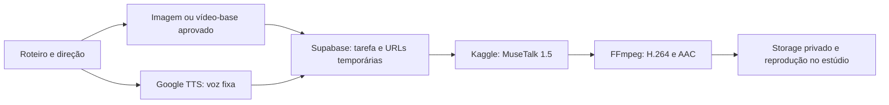

# Arquitetura de vídeo sincronizado — 08/11/2026

## Estado da entrega

Backend e interface implementados e publicados como **piloto experimental**, com um MP4 real de Ana falando em português. Não confundir piloto com aprovação de qualidade comercial ou com produção diária já demonstrada. As bases permanecem desabilitadas para usuários até aprovação de identidade, enquadramento, licença e boca/rosto.

As quatro referências existentes foram arquivadas privadamente e cadastradas, sem aprovação de produção. Não há pacote de praias/cozinhas/oficinas pré-renderizado nesta entrega. Três contas técnicas e seus objetos foram removidos; os dois MP4s e as auditorias foram preservados. O diagnóstico temporário foi encerrado e confirmou HTTP 410.

## Responsabilidade das ferramentas

| Etapa | Ferramenta | Situação |
|---|---|---|
| Roteiro e direção | OpenRouter gratuito → Groq → Gemini/local, adaptadores existentes | Existente; separado do tempo de GPU |
| Referência de personagem/produto | Cloudflare Workers AI FLUX.2 | Compositor existente; não transforma automaticamente qualquer referência em base MuseTalk aprovada |
| Bases reutilizáveis | Supabase Storage + `mv_presenter_assets` | Catálogo implementado; referências e recortes aprovados por operador |
| Voz fixa | Google Cloud TTS Chirp 3 HD | Ativo; Ana/Aoede, Carla/Kore, Rafael/Charon, Lucas/Puck |
| Movimento de boca | MuseTalk 1.5 no Kaggle T4 | Adaptador real testado; imagem ou vídeo com rosto estacionário e recorte previamente definido |
| Montagem | FFmpeg no mesmo notebook | MP4 H.264 + AAC, sem truncar a fala intencionalmente |
| Coordenação e entrega | Edge `hybrid-video`, Postgres e Storage privado | Implementados: autenticação, claim atômico, progresso, upload temporário e resultado assinado |

O botão do piloto gera a narração com a voz fixa, registra a tarefa e inicia o notebook. O estúdio consulta o estado a cada 15 segundos; recarregar recupera o último ID salvo no navegador. A narração separada e a exportação local anteriores continuam disponíveis. A nova fila é `mv_hybrid_jobs`; resultados técnicos não são inseridos como anúncios aprovados na biblioteca antiga.

## Contrato e limites

- `capabilities`: lista somente bases aprovadas; nenhuma credencial ou caminho interno no navegador.
- `generate`: recebe IDs de base e áudio; valida propriedade do áudio Google concluído. Não aceita código, notebook, URL externa, caminho de outro usuário nem recorte enviado pelo cliente.
- Uma tarefa por combinação usuário/base/áudio; reenvio consulta a original, sem nova GPU.
- Trava global: uma submissão em andamento, até 20 claims por dia UTC; verifica a cota Kaggle antes de iniciar. Falta ou leitura ambígua da cota bloqueia o lançamento.
- Notebook privado, T4, limite de sessão 1.800 s. Recebe somente URLs temporárias e um token aleatório restrito ao callback daquela tarefa; não recebe chaves Kaggle, Google ou Supabase administrativas.
- Callback autenticado por hash, expira em 90 minutos; não reabre tarefas terminais. Upload assinado exclusivo de um objeto, sem sobrescrever. URLs de leitura do resultado duram cinco minutos.
- Áudio de até 15 s; entrada até 1080×1920, vídeo-base até 375 quadros; lote de inferência de um quadro para conter VRAM. Saída preserva dimensões da referência, sem prometer 9:16/4K se a base não as tiver.
- Falha de submissão ambígua vira `uncertain`, sem reenvio automático; ausência de callback vira estado público `expired` no fim do prazo. Não há cancelamento remoto integrado nesta versão.
- RLS forçada nas duas tabelas. Cliente lê apenas metadados aprovados; tarefas e RPC de claim acessíveis somente ao backend. A leitura de resultado exige sessão real e usuário proprietário.
- Novas gerações do fluxo antigo não usam 1min.ai, Replicate, Runway, Magic Hour nem Google vídeo. Adaptadores históricos/polling são preservados; não são fallback deste piloto. Nenhum Secret antigo foi apagado.

## Evidência real inicial

Teste de Ana com referência existente de 640×800 e fala Google de 3,024 s:

| Medição | Resultado |
|---|---:|
| Preparação e download | 108,912 s |
| Pré-processamento de áudio/rosto | 20,462 s |
| Inferência e codificação silenciosa | 7,829 s |
| Total dentro do notebook | 152,378 s |
| Pico CUDA alocado | 7.017.208.320 bytes / 6,54 GiB |
| MP4 | 135.995 bytes, 75 quadros, 25 fps |
| SHA-256 | `e92791db6830d944f8564de2209db9fd9803ea4a504982fd0d9e1567ca5e5bf6` |

Decodificação Chromium: vídeo de 3 s, 640×800, áudio presente e não silencioso. Total do notebook não inclui espera na fila Kaggle nem a preparação anterior do Google. Primeira tentativa falhou na instalação; atualizar Transformers de 4.44.2 para 4.57.6 permitiu concluir a segunda. Revisões de código e pesos fixadas no executor subsequente.

**Inspeção visual:** boca/parte inferior do rosto mais suaves que a fotografia. Corpo permanece parado na entrada por imagem. O adaptador usa recorte fixo e máscara suave própria, não o rastreamento DWPose e parser oficial completo. Esses atalhos reduzem dependências, mas exigem curadoria e comparação de qualidade. Não aprovar ainda para anúncios realistas de corpo inteiro.

## Segundo teste real — fala mais longa

Com revisões de modelos fixadas e a mesma foto de Ana, o pipeline concluiu outra execução na T4:

| Medição | Resultado |
|---|---:|
| Fala de entrada | 8,496 s |
| Preparação e download | 74,318 s |
| Pré-processamento | 17,422 s |
| Inferência e codificação silenciosa | 21,279 s |
| Total dentro do notebook | 127,829 s |
| Registro no banco até callback final | 135 s |
| Pico CUDA alocado | 6,54 GiB |
| MP4 | 243.864 bytes, 212 quadros, 25 fps, 640×800 |
| SHA-256 | `104a149301f6d7b091ba2a4ce19250840bfc7c07e741683aac6bb41ff6ea0487` |

O MP4 longo também foi decodificado no Chromium: 8,48 s de vídeo, 8,448 s de áudio, áudio não silencioso e hash correspondente ao arquivo do Kaggle. O arredondamento para quadros e a codificação AAC explicam diferenças pequenas entre durações; sincronismo percebido ainda exige avaliação.

Os 135 s começam depois da narração pronta, no registro da tarefa. Não representam toda a jornada desde o clique que gera a voz. São duas amostras concluídas, não uma medição de lote aquecido. A preparação menor da segunda execução não demonstra cache persistente: cada pedido ainda usa seu próprio notebook.

Verificações com sessões reais na função publicada: duplicata HTTP 200 com mesmo ID, leitura por outra conta HTTP 404, callback falso HTTP 401 e solicitação sem sessão HTTP 401. A interface publicada foi conferida em desktop e celular com respostas controladas: voz padrão, filtro e aviso de bases pendentes, sem overflow.

## O que falta

1. Ajustar recorte/máscara e comparar com parser facial oficial; avaliar sincronismo percebido, dentes, nariz, textura e identidade nos quatro personagens.
2. Aprovar bases com movimentos naturais e rosto estável, enquadradas em 9:16; carregar ambientes autorizados e separar variantes por roupa/produto/cenário.
3. Conectar a imagem composta específica de cada produto à preparação/aprovação de nova base. A etapa existente FLUX não está automaticamente encadeada ao catálogo do piloto.
4. Amortizar preparação em lote ou sessão reutilizada: esta versão inicia um notebook por tarefa e não conserva modelos carregados entre pedidos. Não apresentar 7,8 s como tempo total do botão.
5. Medir anúncios de 10–15 s e uma sequência de pelo menos 15 tarefas, com falhas, fila e consumo real de cota. Não extrapolar o teste de três segundos como garantia diária.
6. Integrar resultado aprovado à biblioteca principal, cancelamento e supervisão de tarefas sem callback. Preparar 4K somente como ampliação separada, sem afirmar geração nativa.

Trocar camiseta, calça, cenário, identidade ou interação com produto não é função do MuseTalk. Isso exige outra base ou gerador de movimento. Hunyuan/LTX ficam reservados a essa etapa futura, fora do caminho rápido de fala; seus benchmarks anteriores não são benchmarks deste adaptador.

## Publicação e reprodução técnica

- Migração `20261107235204_hybrid_video_pipeline.sql` aplicada no projeto `jzchlrvxdaffnrgbvabv`.
- Fonte executável em `executors/kaggle/hybrid_runner.py`; cópia embarcada em `_shared/runner.ts`, igualdade verificada por teste.
- MuseTalk código `0a89dec45a0192b824e3cf4daf96c239440c5ed8`; pesos MuseTalk `2bcb936e2fddb4d86db4c62fd45b387d0c061571`, VAE `31f26fdeee1355a5c34592e401dd41e45d25a493`, Whisper `169d4a4341b33bc18d8881c4b69c2e104e1cc0af`.
- Supabase: áudio v13, vídeo v54, worker v38, `hybrid-video` v4. Frontend Cloudflare `b078cba9-6f4f-4337-aa2d-7da07482bcfc`.
- Suíte completa: 216 testes passaram. TypeScript frontend/Edge, lint, build estático de 17 rotas e dry run do Worker passaram.

Fontes oficiais: [MuseTalk](https://github.com/TMElyralab/MuseTalk), [inferência](https://github.com/TMElyralab/MuseTalk/blob/0a89dec45a0192b824e3cf4daf96c239440c5ed8/scripts/inference.py). Os tempos acima são medições próprias, não a alegação de velocidade em V100 do fabricante.
